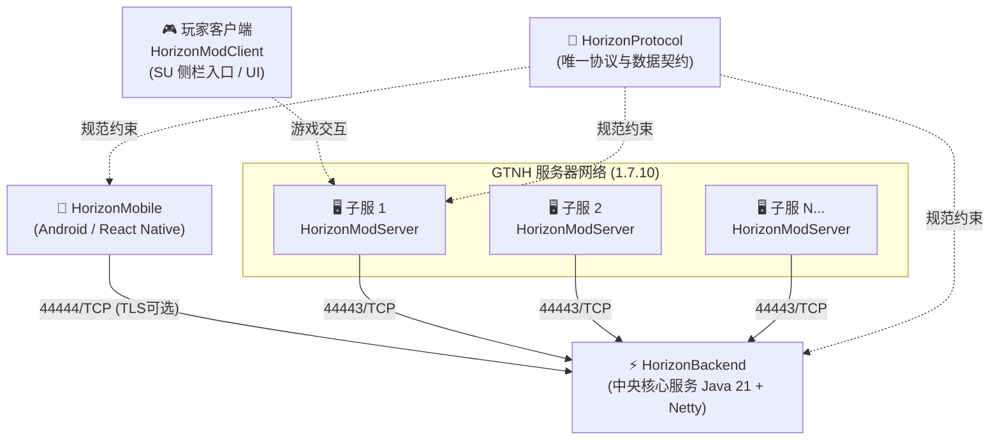
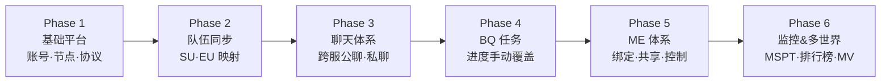

# Deep Space Matrix New Horizon（DSMNH）🌌

  <b>面向 GTNH 的移动端互联与管理生态</b> 
  涵盖中央后端、游戏模组、移动端 App 及唯一真理源协议库

---

## 🏛️ 体系架构全景

---

## 📦 核心仓库矩阵

| 仓库名称 | 语言 / 技术栈 | 职责说明 | 状态 |
| :--- | :--- | :--- | :--- |
| [**HorizonProtocol**](https://github.com/dsmnh/HorizonProtocol) | Markdown / Schema | **协议契约（唯一真理源）** 定义网络帧、各业务消息格式、统一错误码与能力协商。 | 🟡 规划中 |
| [**HorizonBackend**](https://github.com/dsmnh/HorizonBackend) | Java 21 + Netty 4.x SQLite WAL / Gradle | **中央后端服务** 负责全网账号鉴权、节点管理、跨服聊天路由与统一队伍中枢。 | 🟡 待起步 |
| [**HorizonModServer**](https://github.com/dsmnh/HorizonModServer) | Java 8 + Forge 1.7.10 (GTNH RFG) + Mixin | **服务端模组** 运行于 GTNH 各子服，主动连接后端，对接 AE2、性能采样与命令切片。 | 🟡 待构建 |
| [**HorizonModClient**](https://github.com/dsmnh/HorizonModClient) | Java 8 + Forge 1.7.10 | **客户端模组** 可选装，提供 ServerUtilities 侧栏快捷入口、绑定 UI 与方块材质。 | 🟡 待起步 |
| [**HorizonMobile**](https://github.com/dsmnh/HorizonMobile) | React Native / Expo TypeScript / SQLite | **Android 手机客户端** 继承打磨完成的 Telegram 式聊天、TPS 图表与 AE2 终端，接入新后端。 | 🟢 演进自 AEMobileApp 3.6.0 |

---

## 🏛️ 历史与过渡维护仓库（现行体系）

在新体系各阶段（Phase 1 ~ Phase 6）逐步上线期间，现存旧仓库保持正常维护与演进（保留在个人账号，不并入本组织）：

| 仓库名称 | 说明 | 维护策略 |
| :--- | :--- | :--- |
| [**AEMobile**](https://github.com/Huaxidesu/AEMobile) | 旧版单服嵌入式 Forge 模组 (v3.7.1) | 现行稳定版，持续维护至新系统完全替代 |
| [**AEMobileApp**](https://github.com/Huaxidesu/AEMobileApp) | 旧版 Android 客户端 (v3.6.0) | 现行稳定版，作为新 App 的直接源码底座 |
| [**AEMobileBridge**](https://github.com/Huaxidesu/AEMobileBridge) | BungeeCord 通用命令桥插件 (v1.1.2) | 现行维护中 |
| [**AEMobileIcoOutput**](https://github.com/Huaxidesu/AEMobileIcoOutput) | 图标库导出与数据库构建工具 | 持续共用与维护 |
| [**AEMobileDesktop**](https://github.com/Huaxidesu/AEMobileDesktop) | 桌面端实验原型 | 存档保留 |

---

## 🗺️ 六阶段演进路线图

---

  <i>DSMNH Team · Built for the GTNH community</i>

